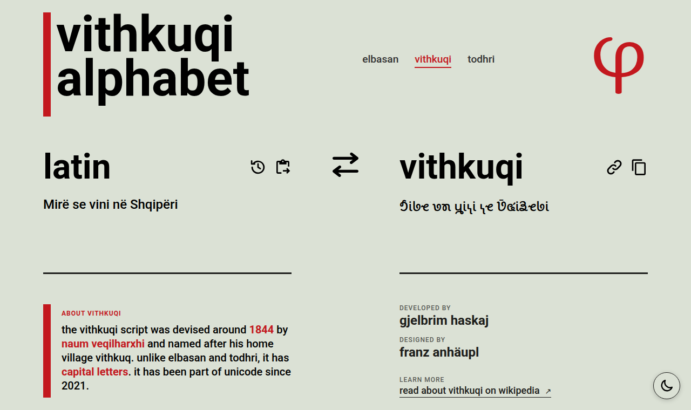

[](https://github.com/gjelbrim/shqipee/actions/workflows/ci.yml)
[](https://github.com/gjelbrim/shqipee/blob/main/LICENSE)

# shqip.ee

Transliterate Albanian text from the Latin alphabet into the historical **Elbasan**, **Vithkuqi** and **Todhri** scripts, and back.

**→ [shqip.ee](https://shqip.ee)**

<picture>
  <source media="(prefers-color-scheme: dark)" srcset="docs/screenshot-dark.png">
  
</picture>

## Features

- **Both directions:** Latin → script and script → Latin, switched with one click; the output becomes the new input.
- **On-screen alphabet** for typing in the script, with a shift key for Vithkuqi capitals (tap for one capital, double tap or hold for caps lock).
- **History** of recent texts per script, restorable with one click, deletable one by one or all at once.
- **Share links:** `https://shqip.ee/<script>?text=…` opens the page with the text filled in; on phones the system share sheet opens.
- **Copy and paste** buttons for the clipboard.
- **Installable and offline:** a PWA that works without a connection once loaded, fonts included.
- **Dark mode**, following the system setting until you pick one.
- **Accessible:** keyboard-operable, labelled for screen readers, with language tags for each script.

## The scripts

| Script | Page | Origin | Unicode |
|---|---|---|---|
| [Elbasan](https://en.wikipedia.org/wiki/Elbasan_alphabet) | [shqip.ee](https://shqip.ee/) | 18th century, central Albania | U+10500–U+1052F (since 2014) |
| [Vithkuqi](https://en.wikipedia.org/wiki/Vithkuqi_alphabet) | [shqip.ee/vithkuqi](https://shqip.ee/vithkuqi) | around 1844, Naum Veqilharxhi; has capital letters | U+10570–U+105BF (since 2021) |
| [Todhri](https://en.wikipedia.org/wiki/Todhri_alphabet) | [shqip.ee/todhri](https://shqip.ee/todhri) | 18th century, named after Dhaskal Todhri | U+105C0–U+105FF (since 2024) |

Digraphs such as `sh`, `gj` or `xh` become one letter where the script has one. Elbasan and Todhri have no capitals, so input is lowercased; Vithkuqi keeps the case. Few fonts support these scripts yet, so the site ships its own (Noto Sans Elbasan, Noto Sans Vithkuqi, Noto Serif Todhri).

## Development

Requires Node.js 22.

```bash
npm ci            # install dependencies
npm run dev       # dev server on http://localhost:5173
npm test          # unit tests (Vitest)
npm run check     # type check (svelte-check, JSDoc types)
npm run build     # production build into ./dist
npm run preview   # serve the production build
```

CI runs `check`, `test` and `build` on every pull request. The site is deployed on [Vercel](https://vercel.com); `vercel.json` holds the rewrites and security headers.

Built with [Svelte 5](https://svelte.dev/) and [Vite](https://vite.dev/), without a UI framework or router library. The character maps live in [`src/data/mappings.js`](src/data/mappings.js), the transliteration in [`src/utils/transliterate.js`](src/utils/transliterate.js). [`CLAUDE.md`](CLAUDE.md) describes the architecture in detail.

## Credits

- Developed by [gjelbrim haskaj](https://github.com/gjelbrim)
- Designed by [franz anhäupl](https://github.com/Litorian113)

## License

The code is licensed under the [GNU General Public License v3.0](LICENSE). The fonts in [`src/assets`](src/assets) (Roboto, Noto Sans Elbasan, Noto Sans Vithkuqi, Noto Serif Todhri) are licensed under the [SIL Open Font License 1.1](src/assets/OFL_roboto.txt).
